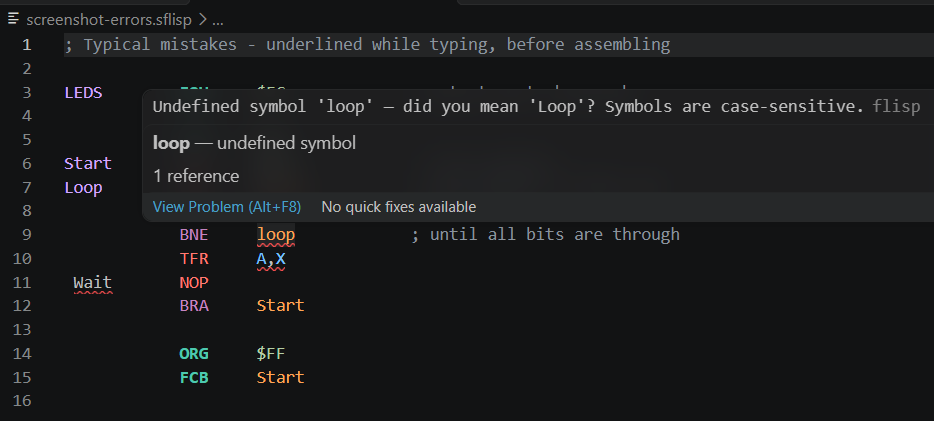
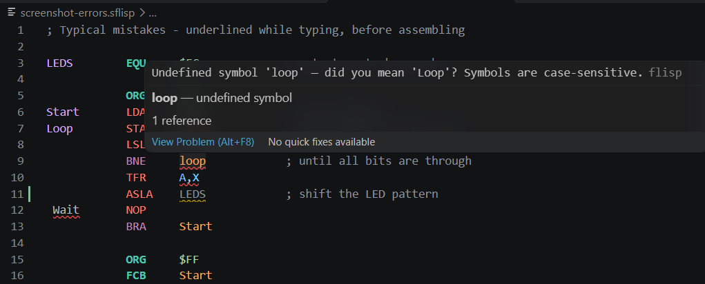
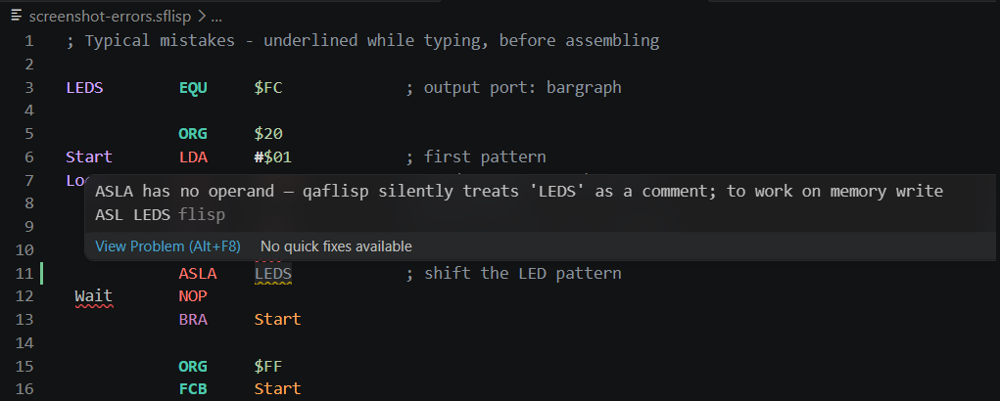
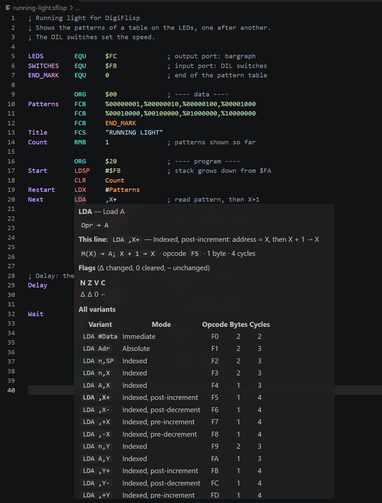
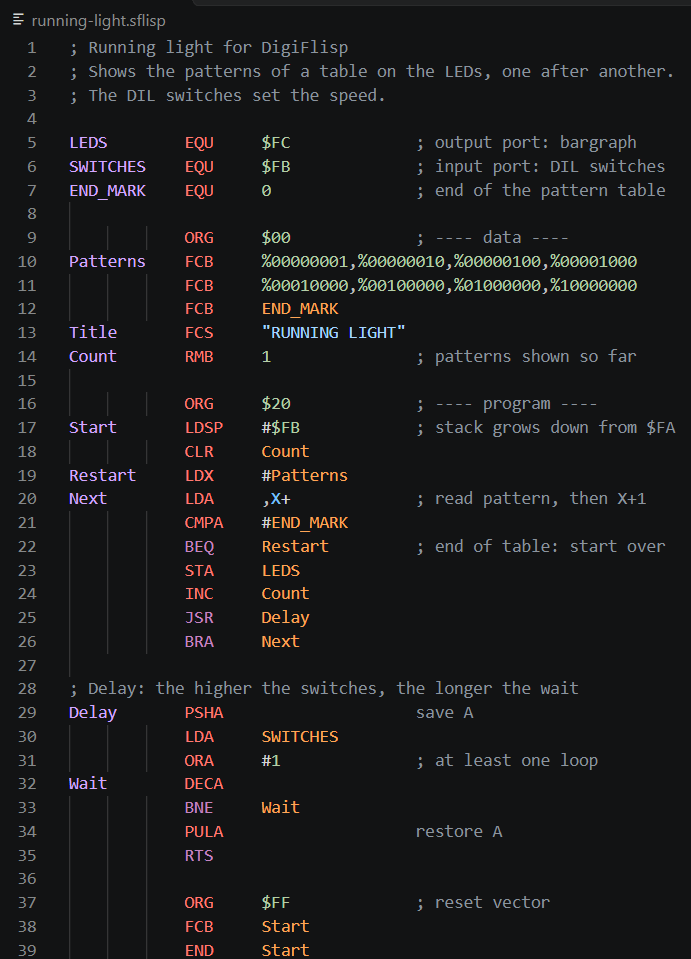
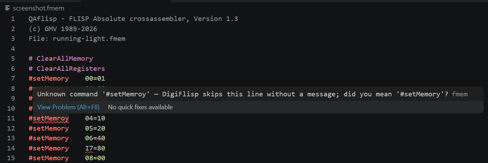

# FLISP Assembly for VS Code — User Guide

The complete description of the extension. For a short overview see the [Marketplace page](https://marketplace.visualstudio.com/items?itemName=janibert.flisp-asm).

- [Assembling](#assembling)
- [Checks while typing](#checks-while-typing)
- [Hover](#hover)
- [Labels and symbols](#labels-and-symbols)
- [Suggestions](#suggestions)
- [Columns: Tab and formatting](#columns-tab-and-formatting)
- [Highlighting](#highlighting)
- [`.fmem` files](#fmem-files)
- [Settings](#settings)
- [Installation and where qaflisp is looked for](#installation-and-where-qaflisp-is-looked-for)
- [Limitations](#limitations)

To try the checks, open the files in [`flisp-asm-src/test/examples`](../flisp-asm-src/test/examples): one topic per file, every line says in its comment what the extension reports, and the header suggests what to change.

## Assembling

The extension runs the `qaflisp` assembler on the current file and shows its errors directly in the editor.

- **Run it:** the ▶ button in the editor title bar, `F7`, *FLISP: Assemble* in the command palette, or right-click a `.sflisp` file in the Explorer. Unsaved changes are saved first.
- **Errors and warnings** are underlined in the source and listed in the *Problems* panel. The full qaflisp output is in the *FLISP* output channel.
- **Output files** (`.s19`, `.lst`, `.fmem`) are written next to the source file. Load the `.fmem` into DigiFlisp. The `.lst` list file shows the address and the bytes of every line.

`qaflisp` comes with [DigiFlisp](https://www.gbgmv.se/studies.html). The extension finds the qaflisp of an installed DigiFlisp automatically. On Windows it also works without DigiFlisp: a copy of `qaflisp.exe` is bundled with the extension.

| Platform | Status |
|---|---|
| Windows | tested |
| Linux x64 | qaflisp from DigiFlisp 2.08 checked: same messages and same output files as on Windows; the extension itself not yet tested on Linux |
| macOS | install location and message format checked in the DigiFlisp 2.08 packages; not tested on a Mac |

Feedback from Linux and macOS users is welcome — please open an [issue](https://github.com/janibert/FLISP/issues).

Assembling runs an external program and is therefore disabled in [untrusted workspaces](https://code.visualstudio.com/docs/editor/workspace-trust); everything else works everywhere.

## Checks while typing

Mistakes are underlined immediately, without assembling. The extension reads the code the way qaflisp does: it finds the errors qaflisp would report (red), and it warns (yellow) about code that qaflisp accepts **without any message** although it most likely does not do what was meant. After assembling, qaflisp's own messages take the place of the live check on the same lines; editing a line removes the outdated qaflisp message there.

**Line structure and labels**

| Example | Message |
|---|---|
| ` Start  NOP` (indented label) | error — a label must start in column 1 |
| `LDA #1` in column 1 | error — a mnemonic in column 1 is read as a label |
| `NOP` alone in column 1 | warning — only a label, no code (missing indent) |
| `BRA loop` with label `Loop` | error — undefined symbol; symbols are case-sensitive, the message suggests `Loop` |
| `END Strat` with label `Start` | warning — undefined start symbol; qaflisp only warns |
| a label defined twice | error on every defining line |

A label may be named like a mnemonic (`Neg EQU 3`, `End NOP`) — qaflisp accepts that.

**Operands and addressing modes**

| Example | Message |
|---|---|
| `STA #5`, `CLR ,X+` | error — the instruction has no such addressing mode; the message lists the allowed forms |
| `TFR A,X` | error — register pair not allowed |
| `LDA`, `#5,X`, `,X`, `3,PC` | error — missing or malformed operand |
| `ORG`, `RMB`, `FCB`, `FCS`, `K EQU` without a value | error — the directive needs an operand |
| `EQU 5` without a name in column 1 | error — no label for `EQU` |
| `FCS Text`, `FCS 'A'`, `FCS ""` | error — `FCS` needs a string with at least one character; for single bytes use `FCB` |
| `FCS ""x"`, `FCS "a""b"`, `FCS "a"Foo` | warning — qaflisp silently takes the second `"` as the first character, or ignores what follows the string; write `\"` for a quote inside a string |
| `ASLA Data`, `NOP #5` | warning — the instruction has no operand, qaflisp silently treats the rest as a comment; for `ASLA Data` the message suggests `ASL Data` |

**Numbers and expressions**

| Example | Message |
|---|---|
| `0a`, `%0102`, `$FG`, `0x1F` | error — the digit does not fit the base; `0a` suggests `$0A` |
| `EQU #$FB`, `LDA 2+#1` | error — `#` only at the start of an instruction's operand |
| `2*(3`, `2+`, `2**3`, `1<2`, `X+1`, `5/0` | error — expression syntax, register name, division by zero |
| `(2+)`, `1~2` | warning — qaflisp silently uses 0 for the missing value, or drops the value before `~` |
| `FCB 1,2 3,4` | warning — the blank ends the operand, `3,4` silently becomes a comment |

Expressions are evaluated as qaflisp does — with only two precedence levels, both from left to right: `* / %` before `+ - & | ^ << >> && ||`. So `2<<1+1` is 5, not 8 as in C. `%` after a value is modulo (`7%3`).

**Values and addresses**

The extension computes the address of every line as qaflisp does.

| Example | Message |
|---|---|
| `FCB 300`, `LDA #K*4`, `LDA Table+300` | error — the value does not fit in a byte (−256 … 255) |
| `BRA Far` | error — a branch reaches only −128 … +127 bytes from the next instruction; the message suggests `JMP` or `JSR` |
| code or data beyond `$FF` | warning — the memory has 256 bytes; qaflisp silently continues at `$00` |
| `ORG $100` | warning — outside the memory |

**`ORG` and `RMB`**

qaflisp evaluates `ORG` and `RMB` in its first pass, when later labels are not known yet. It then reports *Forward reference* — or a *Phase error* at a completely different line. The live check shows the cause on the `ORG` or `RMB` line:

| Example | Message |
|---|---|
| `ORG Far` with `Far` further down | error — Forward reference |
| `RMB End-Start` with `End` further down | error — the size depends on a later label |
| `RMB K` with `K EQU Start+4` | error — a constant that contains a label is unknown in the first pass |

Using labels from above directly (`ORG Start+4`, `RMB End1-Start`) is fine.

## Hover

**Over a mnemonic** — what the instruction does, tailored to the line you are on:

- what the instruction does, in the notation of the FLISP handbook (e.g. `Opr → A`),
- **this line**: the addressing mode used here, the exact operation (e.g. `LDA ,X+` → `M(X) → A; X + 1 → X`), opcode, length in bytes and clock cycles — or a hint if the instruction has no such addressing mode (e.g. `STA #5`),
- which flags are changed (N, Z, V, C — and I where it applies),
- a table of all variants with opcode, bytes and cycles; the one used on the line is highlighted.

Directives (`ORG`, `EQU`, `FCB`, …) and the lab instructions get a short explanation. Opcodes and lengths are checked against qaflisp; cycles and flags come from the FLISP handbook.

**Over a symbol** — its defining line, the number of uses, and the **address** of a label or the **value** of a constant in hex, decimal and binary, e.g. `$16 = 22 = %00010110`.

## Labels and symbols

| Feature | How |
|---|---|
| Go to the definition | `F12` or `Ctrl`+click on a symbol, e.g. on `Loop` in `BRA Loop` |
| Find all uses | `Shift+F12`; clicking a symbol also highlights all its occurrences |
| Overview of all labels | *Outline* view, breadcrumbs, or `Ctrl+Shift+O` — code labels, data (`FCB`, `FCS`, `RMB`) and constants (`EQU`) have their own icons |
| Rename | `F2` on a symbol renames its definition and every use |

## Suggestions

Suggestions (`Ctrl+Space`, or while typing) depend on the column you are in:

| Column | Suggested |
|---|---|
| label | symbols that are used but not defined yet |
| mnemonic | mnemonics with a short description, directives, lab instructions |
| operand of a branch, jump or `END` | code labels first |
| after `#` | constants (`EQU`) first |
| after a comma | only the index forms the instruction allows, e.g. `X+`, `-Y` after `LDA ,`, or `X`, `Y`, `SP` after `CLR 2,` |
| operand of `TFR` / `EXG` | the allowed register pairs |
| other operands | data labels, constants, code labels |
| comment, inside a number | nothing |

VS Code's general word suggestions are switched off for FLISP, so only these appear.

In the label and mnemonic columns, **Tab** accepts the suggestion and moves on to the next column in one go (`JM` + Tab → `JMP`, cursor in the operand column). In the operand column Tab only accepts, because an expression may continue (`Tab+1`). Enter always just accepts.

## Columns: Tab and formatting

FLISP code reads best as a table: label, mnemonic, operand, comment. The extension keeps these columns aligned (default: columns 0, 12, 20 and 36):

- **Tab** jumps to the next column, filling with blanks; **Shift+Tab** goes back to the previous one (removing the blanks before the cursor). With a selection, Tab indents as usual.
- **Format Document** (`Shift+Alt+F`, or right-click in the editor) aligns all lines; with text selected, *Format Selection* (`Ctrl+K Ctrl+F`, also in the context menu) aligns only the selected lines. Only blanks change, never the meaning: comments without `;` stay comments, strings stay untouched, and lines with a structural error (e.g. an indented label) are left as they are, so the live check can still point to them.
- `.sflisp` files use blanks instead of tab characters, and VS Code's indentation guides (useful for nested code, not for assembly) are switched off for FLISP.

To format on every save, add `"[flisp]": { "editor.formatOnSave": true }` to your settings. Other columns: set `flisp.columns`. If you would like vertical lines at the columns, add `"[flisp]": { "editor.rulers": [12, 20, 36] }` — they run through every line, including comment lines.

## Highlighting

The grammar follows the *FLISP-Handbok* and the `qaflisp` assembler.

| Element | Example |
|---|---|
| Comments | `; text to end of line` and everything after the operand |
| Labels | name in column 1, optionally followed by `:` |
| Symbols | labels and `EQU` constants used in an operand, e.g. `BRA Loop`, `STA LEDS` |
| Assembler directives | `ORG`, `EQU`, `FCB`, `FCS`, `RMB`, `END` — **bold** and in a different colour than instructions, so instructions for the assembler stand apart from instructions for the processor |
| Flow-control instructions | `JMP`, `JSR`, `BSR`, `BRA`, `RTS`, `RTI`, all `B…` branches |
| Other instructions | from the FLISP handbook, plus aliases `ASLA`/`ASL`, `PSHCC`, `PULCC` |
| Lab instructions | `MOVE`, `CMJEQ` — *italic and underlined* |
| Numbers | `$3F` hex, `%01000000` binary, `42` decimal, `'A'` character; a number with a digit that does not fit its base is shown as invalid |
| Immediate | `#` — **bold**, because `LDA #5` (the value 5) and `LDA 5` (memory cell 5) are easy to confuse |
| Registers | `A`, `X`, `Y`, `SP`, `PC`, `CC` |
| Indexed addressing | `n,SP` · `n,X` · `A,Y` · `,X+` · `,X-` · `,+Y` · `,-Y` |
| Strings | `"TEXT"` for `FCS` |
| Errors | a mnemonic in column 1 followed by an operand (qaflisp reads it as a label: *Illegal mnemonic*) |

**Line structure and comments.** qaflisp reads every line as `[Label] Mnemonic [Operand] [Comment]`:

- Column 1 is always a label. An instruction must be indented.
- The operand ends at the first space (except inside a string). Everything after it is a comment, even without `;`. So `LDA #K + 1` loads `K`, not `K+1` — the ` + 1` is a comment and is shown in grey. Write `LDA #K+1` instead.
- For instructions without an operand (`NOP`, `PSHA`, `RTS`, `INCA` …), everything after the mnemonic is a comment.
- `END` takes an optional operand: the start symbol, e.g. `END Start`. It sets the start address in the `.s19` file (S9 record). Text after `END` is therefore *not* a comment unless it starts with `;` — `END Rest of line` makes qaflisp look for a symbol `Rest` and warn *start symbol 'Rest' is defined* (meaning: not defined).

**Lab instructions.** `MOVE` and `CMJEQ` are not standard instructions; neither the handbook nor qaflisp knows them. They get the scope `entity.name.type.instruction.custom.flisp`, which the extension renders *italic and underlined* by default so they stand out.

## `.fmem` files

`.fmem` files (memory images for DigiFlisp) are highlighted: `#setMemory` with address and value, `# ClearAllMemory` and `# ClearAllRegisters` with their own colour, the header lines as comments.

They are also checked while typing: unknown commands (with a hint for typos such as `#setMemroy`), addresses and values that are not 1–2 hex digits (`#setMemory 2G=05`), a missing `=` or value, a command without `#`, and an address that is set twice. DigiFlisp itself reports none of these: it skips unknown lines silently and reads invalid hex digits as 0 (`#setMemory 2G=88` writes to `$20`). `#setRegister` gets a warning, because it had no effect in DigiFlisp 2.08.

`.fmem` files have columns too: the command in column 0, its argument in column 14, a comment in column 24 (setting `flisp.fmemColumns`). Tab / Shift+Tab and *Format Document* work as in `.sflisp` files; header lines and lines with an unknown command are left unchanged. In the command column, suggestions offer only the four commands; Tab after `#setMemory` or `#setRegister` moves on to the argument column.

## Settings

The settings are also listed with their descriptions in VS Code: Extensions view → *FLISP Assembly* → *Features* → *Settings*.

| Setting | Default | Meaning |
|---|---|---|
| `flisp.qaflispPath` | empty | path to `qaflisp.exe` |
| `flisp.assembleOnSave` | `false` | assemble automatically on every save |
| `flisp.listFile` | `true` | create a `.lst` list file (`-L`) |
| `flisp.warnings` | `true` | report warnings (`-w`) |
| `flisp.debugInfo` | `false` | generate source-level debug information (`-g`) |
| `flisp.columns` | `[12, 20, 36]` | start columns of mnemonic, operand and comment, for Tab and formatting |
| `flisp.fmemColumns` | `[14, 24]` | start columns of argument and comment in `.fmem` files |

## Installation and where qaflisp is looked for

**From the Marketplace** — in VS Code open the Extensions view (`Ctrl+Shift+X`), search for *FLISP Assembly* and click *Install*.

**As a `.vsix`** — in VS Code press `Ctrl+Shift+P` → *Extensions: Install from VSIX…* → select the file (from the [GitHub releases](https://github.com/janibert/FLISP/releases)).

**As a folder** — copy the `flisp-asm-src` folder to `%USERPROFILE%\.vscode\extensions\` (Windows) or `~/.vscode/extensions/` (macOS/Linux) and restart VS Code.

Requires VS Code 1.63 or later.

qaflisp is looked for in this order:

1. the path in the `flisp.qaflispPath` setting — if set, nothing else is tried;
2. the source file's folder and its parent folders, up to the workspace folder;
3. the workspace folders;
4. the `PATH`;
5. the DigiFlisp installation folder:
   - Windows: `Program Files (x86)\GMV\DigiFlisp*` or `Program Files\GMV\DigiFlisp*`
   - Linux: `/usr/share/digiflisp` (the `.deb` package); the `.tar.gz` instructions install to `/usr/bin`, which is on the `PATH`
   - macOS: `/Applications/Digiflisp.app/Contents/MacOS` or `~/Applications/Digiflisp.app/Contents/MacOS`
6. on Windows, the copy bundled with the extension (qaflisp 1.3).

So a newer qaflisp in your workspace, on the `PATH` or next to DigiFlisp always takes precedence over the bundled one. The *FLISP* output channel shows which `qaflisp.exe` was used. If none is found, a message offers to pick it with a file dialog.

## Characters, encodings and line endings

**Write FLISP programs in 7-bit ASCII.** FLISP and DigiFlisp know only ASCII. Letters such as å, ä, ö, ü, ß or € belong in comments only — there they are fine in every encoding.

qaflisp reads the raw bytes of the file, while VS Code hides some of them. The live check therefore also looks at the bytes of the saved file:

| In the file | What qaflisp does | Live check |
|---|---|---|
| `Över NOP`, `LDA #Låda` | error in every encoding | error — only ASCII outside comments |
| `FCS "på"` | writes the bytes of the file: `å` is 2 bytes in UTF-8, 1 in Windows-1252 | warning; later addresses are computed with the real size |
| `LDA #'å'` | error in a UTF-8 file, the code-page value otherwise | error in UTF-8, warning otherwise |
| UTF-8 **with BOM** (an invisible mark some editors put at the start) | *Illegal mnemonic* in line 1, the line is lost | error on line 1; quick fix: status bar → *Save with Encoding* → *UTF-8* |
| UTF-16 | cannot read the file | error; save as UTF-8 |
| lines ending with **CR only** (old Mac format, or mixed line endings from other editors) | no line break: two lines become one, line numbers shift | warning; quick fix: save with Ctrl+S — VS Code writes uniform line endings |

To try it, open the [examples](https://github.com/janibert/FLISP/tree/main/flisp-asm-src/test/examples) 8 to 11: a running light by a Swedish student in UTF-8 and in Windows-1252, a file with a BOM and one with mixed line endings.

CRLF (Windows) and LF (Linux, macOS) both work. The encoding (UTF-8 or a single-byte code page such as Windows-1252 / ISO 8859-1) is detected from the bytes; for a pure ASCII file the setting `files.encoding` decides — which does not matter as long as the program is ASCII.

## Limitations

- No debugger — use DigiFlisp to run and debug the program.
- Labels and symbols work within one file.
- After a label defined twice, the live check stops computing addresses and leaves the rest to assembling.
- On Linux and macOS, assembling needs an installed DigiFlisp (or another qaflisp).

---

*This extension is not affiliated with or endorsed by GMV (Göteborgs MikroVaror), the maker of DigiFlisp and qaflisp, nor by Chalmers or any other university or course. The bundled `qaflisp.exe` and the DigiFlisp icon are used under the DigiFlisp software license — see [THIRD-PARTY-NOTICES.md](../flisp-asm-src/THIRD-PARTY-NOTICES.md).*
